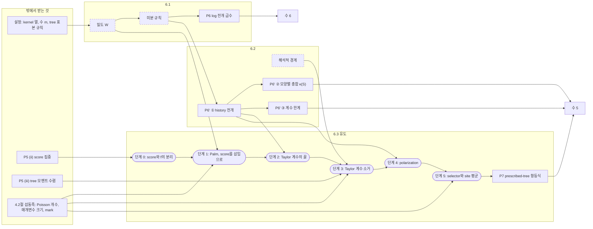

# 구조표 — 수 4 (prescribed-tree 항등식), 현행

2026-11-14. 작성: Fable 5.2. `redesign/layers/L2.md` 212–449행과 `redesign/layers/rules.md` 의 P5–P7 행을 있는 그대로 옮겼다. 고친 것도 다시 지은 것도 없다. 관찰(5절)만 작성자의 해석이다.

주의: 현행 §6은 수 4 시범이 이미 들어간 판이다(커밋 `708f173`, `5c37e0e`). 단위 틀로 다시 쓰기 전의 판은 커밋 `df9744b` 에 있다. 구조(무엇이 규칙 행인가)는 시범 전후로 같다.

## 1. 증명 지도

실선 상자는 규칙 표의 행이다. 점선 상자는 유도에 쓰이지만 행이 아닌 재료다. 둥근 상자는 6.3의 유도 단계다.

## 2. 대상

| 대상 | 현행에서의 지위 |
|---|---|
| path, tree $\mathcal T$, kernel 열 $K_d$, 수 $m_0<\cdots<m_L$ | 6.1 설정에서 정의 |
| 삽입 $A$, $Y_d$ 재귀, 바뀐 kernel $K_d^A$, 밀도 $W_{\mathcal T}(A)$ | 6.1 설정에서 정의. 규칙 행은 아니다 |
| 다루는 양 $E^{A}_{\mathcal T}[G/A^{a_*}]$ | 6.2 ① 주 식의 좌변으로만 나온다 |
| extension history $E$, 계수 $c_E$ | 6.2 ①에서 정의 |
| **미분이 작용하는 상태** | **이름이 없다.** history의 설명 안에 "현재 tree", "이미 color를 받은 leaf", "anchor는 고를 수 없다"로 흩어져 있다 |

## 3. rule

### 규칙 표의 행

| 행 | 진술 | 유형 | 진술 길이 | 차이 칸 길이 | 근거 카드 | 수 4 유도에서 쓰이는 곳 | 다른 수에서 |
|---|---|---|---|---|---|---|---|
| P6 | $\log Y_0$ 의 tree 급수 | exact | 781자 | 605자 | 2 | **없음** | 수 6 |
| P6′ ① | history 전개 | blackbox | 셋 합쳐 1604자 | 1938자 | 5 | 단계 2, 단계 4 | 없음 |
| P6′ ② | 모양별 총합 $\kappa(S)$ | 〃 | 〃 | 〃 | 〃 | **없음** | 수 5 |
| P6′ ③ | 계수 한계 | 〃 | 〃 | 〃 | 〃 | **없음** | 수 5 |
| P7 | prescribed-tree 항등식 | blackbox | 815자 | 1412자 | 4 | 이 수의 출력 | 수 5 |

비교: 다른 열 개 행의 진술 길이는 167–530자다.

### 행이 아닌 재료

| 재료 | 나오는 곳 | 근거 카드 | 쓰이는 곳 |
|---|---|---|---|
| 밀도 $W_{\mathcal T}$ | 6.1 설정 | `tree:density` | 미분 규칙, 단계 1 |
| 미분 규칙 (protected leaf와 fresh path) | 6.2 ①의 "규칙이 나오는 곳" 문단 | `x:tree-differentiation-rule` | P6과 P6′ ①의 공통 근거 |
| 첫 변분 | 같은 문단 | `tree:first-variation` | 미분 규칙 |
| telescoping $\sum_\beta(-\gamma_\beta)=\lvert\mathcal T\rvert$ | 6.1, 6.2 ② | `tree:telescoping` | $Q_k$ 의 정규화, $\kappa(S)$ |
| 해석적 경계 | 6.2 단서 | `x:tree-analytic-bounds` | 단계 3 |
| Palm 항등식 | 6.3 단계 1 | `pert:palm` | 단계 1 |
| 매개변수 크기 논법 ($t_\nu=1/j$, $u_\nu\sim j^{-j}$) | 6.3 단계 3 | `pert:analytic` | 단계 3 |
| polarization | 6.3 단계 4 | `pert:tree-identity` 증명 안 | 단계 4 |
| mark selector | 6.3 단계 5 | `pert:tree-identity` 증명 안 | 단계 5 |

## 4. 유도 (6.3)

| 단계 | 하는 일 | 부르는 행 | 부르는 행 아닌 재료 |
|---|---|---|---|
| 0 | anchor에서 본 score와 $f$ 가 분리된다 | P5 (ii) | 없음 |
| 1 | score의 한 항을 골라내 삽입으로 바꾼다. anchor가 상쇄된 기대값이 나온다 | 없음 | Palm 항등식, 밀도 $W$ |
| 2 | 그 기대값의 Taylor 계수가 tree 모멘트의 유한 결합임을 읽는다 | P6′ ① | 없음 |
| 3 | 모든 Taylor 계수가 0으로 감을 보인다 | P5 (iii) | 해석적 경계, 매개변수 크기 논법 |
| 4 | 한 방향의 계수에서 혼합 미분으로 넘어간다 | P6′ ① | polarization |
| 5 | mark로 제약을 고르고 site를 평균한다 | 없음 | mark selector |

출력: P7.

## 5. 나머지 (blackbox로 둔 것)

- "해석적 경계와 protected leaf 회계": P6, P6′ 의 증명. 카드 7장(`tree:insertion`, `tree:log-expansion`, `tree:extension-expansion`, `x:tree-extension-history`, `x:tree-differentiation-rule`, `tree:reference-total`, `tree:charging`).
- "Taylor 계수 추출": P7의 증명. 카드 3장(`pert:tree-identity`, `pert:palm`, `pert:analytic`).
- 깊이 미루기는 P6′ ③의 단서에서 언급되지만 P8의 증명에 속한다.

## 6. 센 것

| 항목 | 값 |
|---|---|
| 규칙 표의 행 | 3 (P6, P6′, P7). P6′ 안의 진술을 나누면 5 |
| 행이 아닌 재료 | 9 |
| 6.3 유도의 단계 | 6 |
| 그 가운데 규칙 행을 부르는 단계 | 4 (P5 둘, P6′ ① 둘) |
| 행 아닌 재료만으로 가는 단계 | 2 (단계 1, 5) |
| 수 4의 유도가 부르는 §6의 행 | P6′ ① 하나 |
| 본문 길이 | 6.1 약 4,700자 / 6.2 ① 5,500자 / ② 2,500자 / ③ 3,100자 / 6.3 9,000자 |
| 수 4의 유도에 쓰이지 않는 부분의 길이 | ②와 ③ 5,600자, 그리고 6.1의 급수 부분 |

## 7. 관찰 (작성자의 해석)

1. **수 4의 유도가 실제로 부르는 §6의 규칙은 P6′ ① 하나다.** P6의 급수는 수 6으로, P6′ ②③은 수 5로 나간다. 셋은 같은 설정을 쓴다는 이유로 이 절에 모여 있다.
2. **P6과 P6′ ①을 함께 낳는 미분 규칙은 행이 아니다.** 본문 한 문단과 카드에만 있다. 지도에서 가지가 갈라지는 자리에 있는 것이 점선 상자다.
3. **유도의 재료 가운데 행이 아닌 것이 행보다 많다.** 6.3의 여섯 단계 가운데 둘은 행을 하나도 부르지 않는다.
4. **미분이 작용하는 상태에 이름이 없다.** 그래서 "현재 tree의 자식 수를 그 걸음 직전 기준으로 센다" 같은 갱신 규칙이 단서와 예(계산 예 3)로 전달된다.
5. **P6′ 행은 다른 행의 세 배에서 열 배 길이다.** 진술 셋이 한 행에 들어 있고 소비자가 다르다.
